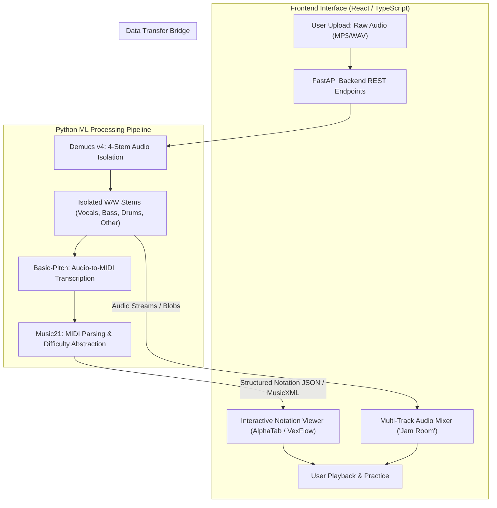

# Project Apollo

[](LICENSE)
[](https://www.python.org/)
[](https://fastapi.tiangolo.com/)
[](https://react.dev/)

> **Etymology & Mythology:** *Apollo* — The Greek god of music, truth, and harmony. The designation represents the definitive mastery and deconstruction of sound, bringing mathematical clarity and structural order to the complex layers of multi-track audio.

---

## 🎵 Overview

**Project Apollo** is an offline-first, browser-based web application orchestrating local music layer separation, stem extraction, and automated notation generation via Python machine learning pipelines and a modern React frontend.

Learning complex music by ear is historically imprecise, especially when critical lines (such as basslines, inner harmony parts, or secondary guitars) are buried deep inside a crowded mix. Project Apollo bridges the operational gap between passive listening and active mastery:
1. Decomposing raw multi-track audio into isolated stems (Vocals, Drums, Bass, Other).
2. Converting isolated audio stems into high-fidelity symbolic MIDI representations.
3. Dynamically parsing and scaling notation difficulty (Beginner, Amateur, Pro) via algorithmic note reduction.
4. Rendering interactive tablature and sheet music alongside a multi-track stem audio mixer ("The Jam Room") for synchronized practice.

---

## 🏛️ System Architecture



### Key Components

- **Backend ML Orchestration (`FastAPI` + `PyTorch`):**
  - **Stem Separation:** Meta's **Demucs v4** decomposes raw audio into four clean, isolated instrument stems.
  - **Audio-to-MIDI Transcription:** Spotify's **Basic-Pitch** translates monophonic and polyphonic stems into raw MIDI data.
  - **Symbolic Music Parsing & Difficulty Reduction:** MIT's **Music21** parses MIDI structures and applies progressive disclosure algorithms (filtering out trills, rapid passing tones, and complex syncopation for beginner/amateur levels).
  - **Asynchronous Task Queue:** Long-running PyTorch jobs execute in background tasks with progress tracking and polling endpoints, preventing API request timeouts.

- **Frontend Application (`React` + `Vite` + `TypeScript`):**
  - **The Jam Room (Multi-Track Mixer):** Synchronized multi-track stem player using the Web Audio API, enabling independent volume control, muting (e.g. mute the bass track to play along), soloing, and tempo adjustment without pitch shifting.
  - **Dynamic Notation Engine:** Renders guitar tablature and standard musical notation via **AlphaTab** / **VexFlow**, synced directly to audio playback and difficulty configurations.

---

## 📂 Repository Structure

```text
Apollo/
├── backend/                  # FastAPI ML backend service
│   ├── app/
│   │   ├── api/              # API routers and endpoints
│   │   │   ├── v1/
│   │   │   │   ├── stems.py  # Audio upload & stem extraction endpoints
│   │   │   │   ├── midi.py   # Transcription & notation endpoints
│   │   │   │   └── tasks.py  # Asynchronous task status polling
│   │   ├── core/             # Configuration, logging, task queue management
│   │   ├── services/         # Core ML & audio processing services
│   │   │   ├── demucs.py     # Demucs v4 separation engine wrapper
│   │   │   ├── transcribe.py # Basic-Pitch audio-to-MIDI engine
│   │   │   └── notation.py   # Music21 difficulty reduction & parsing
│   │   └── main.py           # Application entry point
│   ├── requirements.txt      # Python dependencies
│   └── tests/                # Unit and integration test suite
├── frontend/                 # React + TypeScript frontend
│   ├── src/
│   │   ├── components/       # Mixer, player, notation viewer, uploaders
│   │   ├── hooks/            # Audio context, stem synchronization, task polling
│   │   ├── services/         # API client
│   │   └── App.tsx
│   ├── package.json
│   └── vite.config.ts
├── docs/                     # Architectural decisions, API specifications & guides
├── .gitignore
└── README.md
```

---

## 🗺️ Roadmap & Prioritization

### Phase 1: Backend Foundation & Stem Extraction (Completed)
- [x] Repository initialization, documentation foundation, and environment design.
- [x] Scaffold FastAPI backend architecture with modular router structure.
- [x] Integrate Demucs v4 pipeline for 4-stem local isolation (Vocals, Bass, Drums, Other).
- [x] Build asynchronous task management to decouple audio processing from HTTP requests.
- [x] Implement local storage management and auto-cleanup for temporary stem files.

### Phase 2: Transcription & Notation Logic (Current Focus)
- [ ] Integrate Spotify's Basic-Pitch for audio-to-MIDI stem transcription.
- [ ] Implement Music21 parser for MIDI post-processing and quantification.
- [ ] Develop dynamic difficulty reduction algorithms (Beginner, Amateur, Pro) to strip syncopations and rapid passing tones.
- [ ] Expose notation endpoints outputting structured notation payloads and MusicXML.

### Phase 3: Frontend Scaffolding & Audio Engine (Completed)
- [x] Scaffold React (Vite + TypeScript) application shell.
- [x] Build the interactive multi-track audio mixer ("The Jam Room") with synchronized Web Audio stems.
- [x] Implement independent mute/solo matrices and time-stretch/tempo controls.

### Phase 4: Dynamic Notation Rendering & Polish
- [ ] Integrate AlphaTab / VexFlow for interactive tablature and sheet music display.
- [ ] Synchronize visual playhead cursor with active stem audio playback.
- [ ] Implement dynamic difficulty and notation style toggles.

---

## ⚙️ Prerequisites & Installation

### System Requirements
- **OS:** Windows 10/11, macOS, or Linux.
- **Python:** 3.11+ (recommended for PyTorch, Demucs, and Basic-Pitch compatibility).
- **FFmpeg:** Installed and added to system `PATH` (required for Demucs audio decoding/encoding).
- **Node.js:** v18+ (for frontend development).

### 🚀 One-Command Launch (Recommended)
Start both the FastAPI ML backend and React frontend simultaneously with a single command from the project root:

```bash
# Using Python:
python run.py

# Or using npm:
npm start

# Or using PowerShell:
.\start.ps1
```

Both servers start concurrently:
- **Frontend UI ("The Jam Room"):** `http://localhost:5173`
- **Backend API & Swagger Docs:** `http://127.0.0.1:8000/docs`

To stop both services at any time:
- Press `Ctrl + C` in the active terminal, or run:
```bash
python run.py stop
# Or: npm run stop / .\stop.ps1
```

### Manual Component Quickstarts
#### Backend
```bash
cd backend
python -m venv .venv
# Windows:
.venv\Scripts\activate
# Linux/macOS:
# source .venv/bin/activate

pip install -r requirements.txt
uvicorn app.main:app --reload --port 8000
```

#### Frontend
```bash
cd frontend
npm install
npm run dev
```

---

## 🛡️ Operational Safeguards

- **Asynchronous Task Queue:** Demucs audio separation and Basic-Pitch transcription are computationally intensive operations. All processing is dispatched asynchronously with unique job IDs; the frontend polls `/api/v1/tasks/{task_id}` for progress updates.
- **Disk Space & Session Management:** Extracted audio stems and temporary MIDI files are stored in an isolated session directory (`storage/sessions/{session_id}`) configured with automated cleanup routines to prevent local disk exhaustion.
- **Audio Fidelity:** Stems are preserved in uncompressed WAV format during the transcription phase to prevent compression artifacts from corrupting the pitch detection heuristics.

---

## 📄 License

This project is licensed under the MIT License — see the [LICENSE](LICENSE) file for details.
