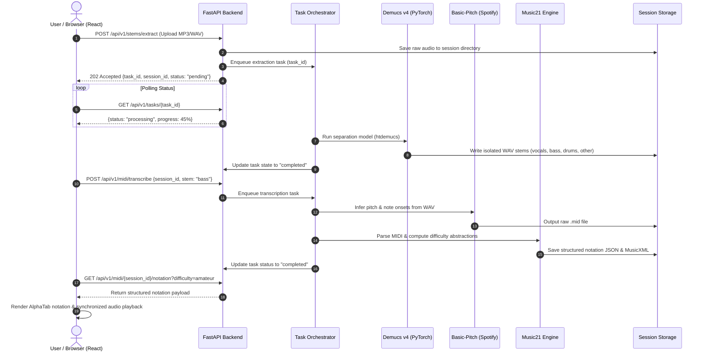

# Architecture & Engineering Specifications

This document outlines the detailed system architecture, processing pipeline, and data flow for **Project Apollo**.

---

## 1. High-Level Concept & Design Objectives

Project Apollo is an offline-first, local-first web application designed to mathematically deconstruct multi-track audio recordings into isolated instrument stems and translate those stems into interactive musical notation (sheet music and tablature) with adaptive difficulty scaling.

### Core Objectives
1. **Local & Privacy-Preserving:** All audio processing, neural network inference, and MIDI parsing execute locally on the host machine without external cloud dependencies or processing subscriptions.
2. **Deterministic & High-Fidelity Separation:** Employs Meta's Demucs v4 architecture to isolate drums, bassline, vocals, and harmonic accompaniment with minimal bleeding.
3. **Non-Blocking User Experience:** Audio separation and neural transcription are computationally heavy; all inference jobs run asynchronously in background workers, decoupling long-running jobs from HTTP request/response lifecycles.
4. **Adaptive Notation Generation:** Uses symbolic MIDI analysis via Music21 to progressively disclose musical complexity, generating Beginner, Amateur, and Pro arrangements.
5. **Interactive Playback ("The Jam Room"):** Multi-track audio engine utilizing the Web Audio API to enable precise stem muting, soloing, balance adjustment, and tempo manipulation without pitch shifting.

---

## 2. End-to-End Pipeline



---

## 3. Subsystem Breakdown

### 3.1 Backend Processing Layer (`FastAPI`)
- **Framework:** FastAPI with Uvicorn worker process.
- **Task Management:** In-memory async worker queue with persistent session state metadata.
- **Audio Decoding / Encoding:** Wrapped via FFmpeg subprocesses and PyTorch/torchaudio.
- **REST Endpoints:**
  - `POST /api/v1/stems/extract`: Ingests audio files, creates a session, and triggers separation.
  - `GET /api/v1/stems/{session_id}`: Returns metadata and download links for separated WAV stems.
  - `GET /api/v1/stems/{session_id}/{stem_name}`: Streams raw or range-requested stem audio.
  - `POST /api/v1/midi/transcribe`: Triggers Spotify Basic-Pitch inference on a specific isolated stem.
  - `GET /api/v1/midi/{session_id}/notation`: Retrieves parsed notation data filtered by difficulty level (`beginner`, `amateur`, `pro`).
  - `GET /api/v1/tasks/{task_id}`: Standard polling endpoint for async job progress, elapsed time, and completion state.

### 3.2 Machine Learning & Audio Engine
1. **Demucs v4 (Hybrid Transformer Demucs / `htdemucs`):**
   - Decomposes input into 4 stereo channels: `vocals`, `drums`, `bass`, `other`.
   - Inference runs on CUDA if available, falling back smoothly to multi-threaded CPU.
2. **Basic-Pitch (Spotify):**
   - Lightweight neural network architecture for monophonic and polyphonic pitch prediction.
   - Outputs continuous frequency contours and discrete note events (pitch, velocity, onset, offset).
3. **Music21 (Symbolic Processing):**
   - Transcribes raw MIDI into discrete musical measures, time signatures, key signatures, and quantized notes.
   - **Difficulty Reduction Rules:**
     - *Pro:* 1:1 match with transcribed notes, preserving all ornamentation and 32nd/64th notes.
     - *Amateur:* Quantizes to 16th-note grids, softens or eliminates rapid non-harmonic passing tones, aggregates rapid repeated notes.
     - *Beginner:* Locks to 8th-note or quarter-note root structures, collapses multi-note polyphonic chords into primary bass/melody lines, and strips trills/pitch bends.

### 3.3 Frontend Architecture (`React` + `TypeScript`)
- **UI Framework:** React with Vite, styled with modern utility-first CSS.
- **Audio Playback Engine ("The Jam Room"):**
  - Manages 4 synchronized `AudioBufferSourceNode` or `HTMLAudioElement` streams routed into independent `GainNode` audio buses.
  - Offers master volume, per-stem gain, solo/mute toggles, and loop-region selections.
  - Uses Web Audio API playback rate adjustments paired with phase-vocoder / SoundTouch time-stretching for tempo modification without pitch alterations.
- **Notation Renderer:**
  - Integrates **AlphaTab** for interactive guitar/bass tablature and score rendering.
  - Synchronizes cursor tracking events directly with audio playback timestamps.

---

## 4. Directory & Session Storage Conventions

Session data is localized under `storage/sessions/{session_id}/`:
```text
storage/sessions/{session_id}/
├── raw/
│   └── input.wav
├── stems/
│   ├── vocals.wav
│   ├── bass.wav
│   ├── drums.wav
│   └── other.wav
├── midi/
│   ├── bass_raw.mid
│   └── bass_quantized.mid
└── notation/
    ├── bass_pro.json
    ├── bass_amateur.json
    └── bass_beginner.json
```

A scheduled cleanup routine monitors session timestamps and purges temporary files exceeding defined retention windows (default: 24 hours), preventing uncontrolled disk expansion.
